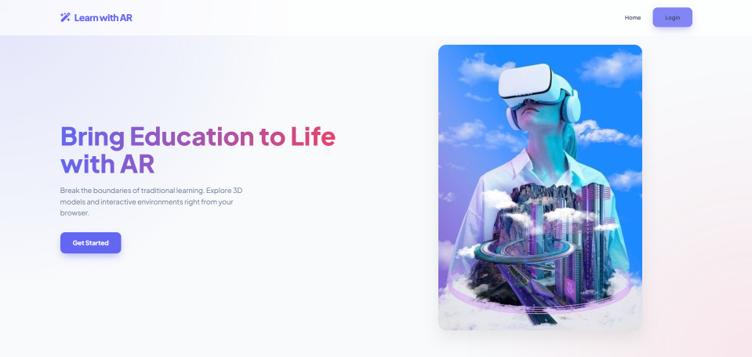
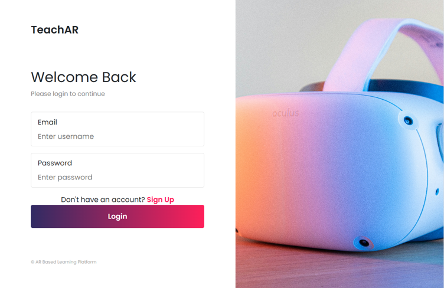
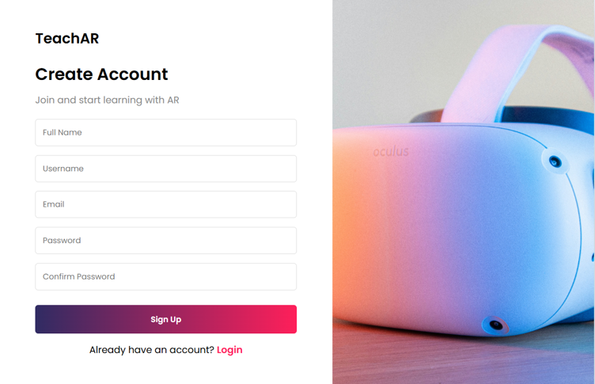
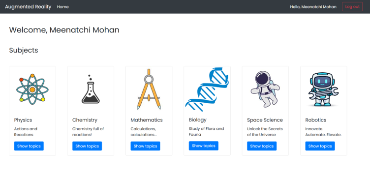
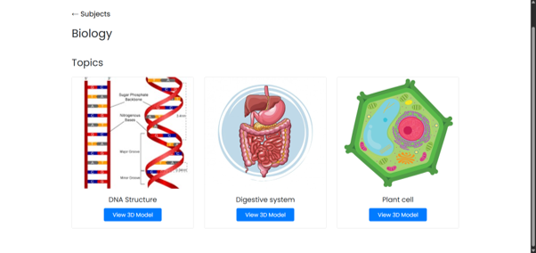
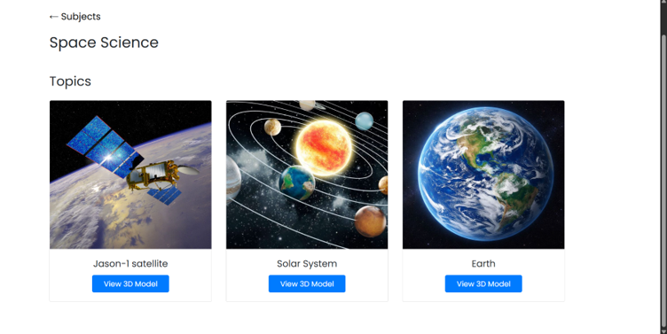
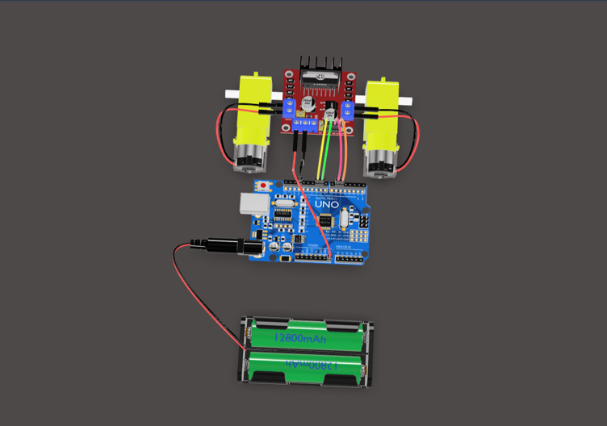

# AR-Based Learning Platform

An interactive web-based learning platform that combines **Augmented Reality (AR)** and **3D visualization** to make educational concepts easier to explore and understand.

## 📌 Project Overview

The AR-Based Learning Platform enables students to explore educational subjects and topics through interactive 3D models in a web browser. Users can rotate, zoom, and examine 3D objects, while hotspot annotations provide additional information about specific parts of a model.

The platform includes user authentication, structured learning content, and an administration interface for managing educational resources.

## ✨ Key Features

- **User Authentication:** Login and logout functionality.
- **Subject Management:** Organizes learning content by subject.
- **Topic Management:** Displays topic details, images, and associated 3D models.
- **Interactive 3D Visualization:** Rotate, zoom, and explore 3D objects.
- **Augmented Reality Support:** View compatible 3D models in AR on supported devices.
- **Hotspot Annotations:** Display additional information about selected model components.
- **Admin Content Management:** Manage subjects, topics, images, and 3D models through Django Admin.

## 🛠️ Technologies Used

| Component | Technology |
|---|---|
| Frontend | HTML, CSS, JavaScript, Bootstrap |
| Backend | Python, Django |
| Database | SQLite |
| 3D Model Viewer | Google `<model-viewer>` |
| AR Support | WebXR / supported browser AR |
| Development Tool | Visual Studio Code |

## 📸 Project Screenshots

The following section showcases the main application interfaces.

### 1. Home Page


### 2. Login Page


### 3. Signup Page


### 4. Subject Selection


### 5. Topic Selection




### 6. Interactive 3D Model Viewer





## ⚙️ Installation and Setup

### Prerequisites

- Python installed on your computer
- pip package manager
- Git
- A web browser

### Steps to Run Locally

**1. Clone the repository**

```bash
git clone https://github.com/Meenatchi2005/AR-Based-Learning-Platform.git
```

**2. Open the project folder**

```bash
cd AR-Based-Learning-Platform
```

**3. Create a virtual environment**

```bash
python -m venv venv
```

**4. Activate the virtual environment**

Windows:

```bash
venv\Scripts\activate
```

**5. Install project dependencies**

```bash
pip install -r requirements.txt
```

**6. Apply database migrations**

```bash
python manage.py migrate
```

**7. Create an administrator account (optional)**

```bash
python manage.py createsuperuser
```

**8. Start the development server**

```bash
python manage.py runserver
```

**9. Open the application**

Visit:

```text
http://127.0.0.1:8000/
```

*Note: These commands assume that `manage.py` and `requirements.txt` are present at the repository root. Follow the project's actual directory structure if they are located elsewhere.*

## 🎯 Project Objectives

- Improve conceptual understanding through interactive 3D learning.
- Organize educational content into subjects and topics.
- Provide an engaging browser-based learning experience.
- Enable administrators to maintain educational resources efficiently.
- Explore the use of AR technology in digital education.

## 🔮 Future Enhancements

- Mobile application integration.
- Voice-based explanations for 3D models.
- Additional interactive educational models.
- Enhanced AR learning experiences.

## 🎓 Project Information

- **Project Title:** AR-Based Learning Platform
- **Project Type:** MCA Mini Project
- **Institution:** Periyar University, Salem
- **Academic Year:** 2025–2026

## 👩‍💻 Author

**Meenatchi M**

## 📄 License

Add a license file if you intend to distribute this project under an open-source license.
### Admin credentials for testing

Username: `admin`

Password: `1234`

